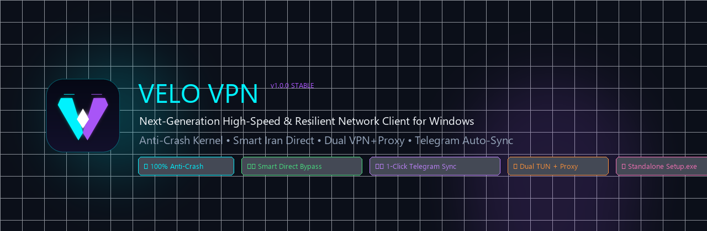
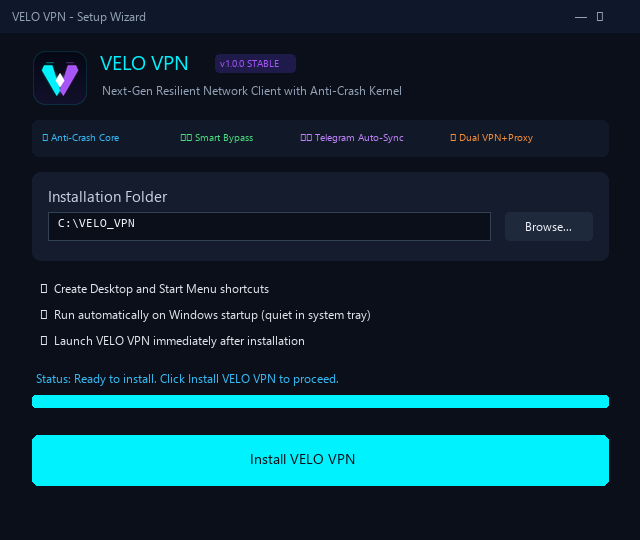
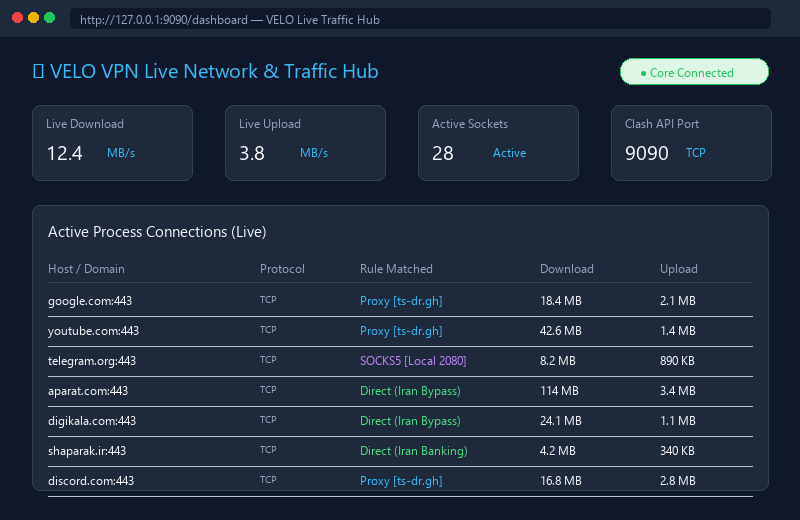

# ⚡ VELO VPN

<p align="center">
  
</p>

<p align="center">
  <a href="https://github.com/mhfa1380/velovpn/releases/latest"></a>
  <a href="#"></a>
  <a href="#"></a>
  <a href="#"></a>
  <a href="#"></a>
</p>

---

## 🌟 Overview

**VELO VPN** is a next-generation, high-performance VPN and proxy client engineered for zero-friction censorship circumvention, peak security, and maximum speed. Built upon the modern **Hiddify / Sing-Box** foundation with custom **VELO** styling, it combines an ultra-modern responsive dark interface with battle-tested routing and tunnel resilience.

### 📥 Instant Download
👉 **[Download Official Installer: VELO_VPN_Setup.exe](https://github.com/mhfa1380/velovpn/releases/download/v1.0.0/VELO_VPN_Setup.exe)**

---

## 🚀 Key Features

- 🎨 **Modern Cyber-Dark Flutter UI:** Ultra-smooth animations, responsive layouts, neon accent palettes, and effortless navigation.
- 🛡️ **Intelligent Iran Direct Bypass:** Zero speed-loss for domestic services. Automatically detects `.ir` domains, Iranian banking, payment gateways, and domestic CIDR blocks without sending them through the VPN.
- ⚡ **Dual Engine (TUN / VPN + System Proxy):** Run high-speed system-wide TUN tunnel and local proxy simultaneously.
- 📱 **1-Click Telegram Proxy:** Instant SOCKS5 / HTTP proxy integration with automatic desktop Telegram binding.
- 🎯 **Split Tunneling & Per-App Routing:** Choose exactly which applications route through the VPN and which stay on your normal local connection.
- 🔄 **Auto-Updating GeoIP & GeoSite:** Daily background synchronization with Chocolate4U's curated Iranian rule sets.
- 🔒 **Zero QUIC/UDP Slice Panics:** Completely eliminated memory slice boundary bugs and connection drops.
- 📦 **Single-File Setup Wizard:** Elegant standalone C# setup installer that handles shortcuts, startup, and dependencies in seconds.

---

## 📸 Screenshots

<p align="center">
  
  
</p>

---

## ⚡ Quick Start

1. **Download & Install:**
   - Grab `VELO_VPN_Setup.exe` from [Releases](https://github.com/mhfa1380/velovpn/releases/latest).
   - Run the installer and click **Install Now**.
2. **Launch:**
   - Open **VELO VPN** from your Desktop or Start Menu.
3. **Connect:**
   - Select your preferred high-speed server (🇩🇪 Germany, 🇺🇸 United States, 🇹🇷 Turkey, etc.) and hit **Connect**.
4. **Telegram Proxy:**
   - SOCKS5 is ready at `127.0.0.1:2080`.
   - Click the 1-click proxy button or open `tg://socks?server=127.0.0.1&port=2080`.

---

## 🛠️ Project Structure

```text
├── assets/                     # Branding, icons, logos, screenshots
│   ├── velo_logo.ico           # Application & tray icons
│   ├── velo_logo.png           # High-resolution cyber emblem
│   └── hero_banner.png         # GitHub hero presentation
├── config/                     # Outbounds and server definitions
│   └── my_configs.txt          # Preloaded VIP nodes
├── installer/                  # Standalone C# Setup Wizard
│   ├── installer_source.cs     # English dark-themed installer source
│   └── build_installer.ps1     # Automated MSBuild compiler script
├── tools/                      # Automation & Control Center
│   ├── Control_Center.ps1      # PowerShell interactive utility
│   ├── Control_Center.bat      # Fast launcher
│   └── auto_update_geo.ps1     # Automated daily geo-rules updater
└── README.md
```

---

## 👤 Author & Credits

- Developed by **velomusic** / [mhfa1380](https://github.com/mhfa1380)
- Core powered by **Sing-Box** & **Hiddify**
- Routing rules powered by **Chocolate4U / Iran-sing-box-rules**
